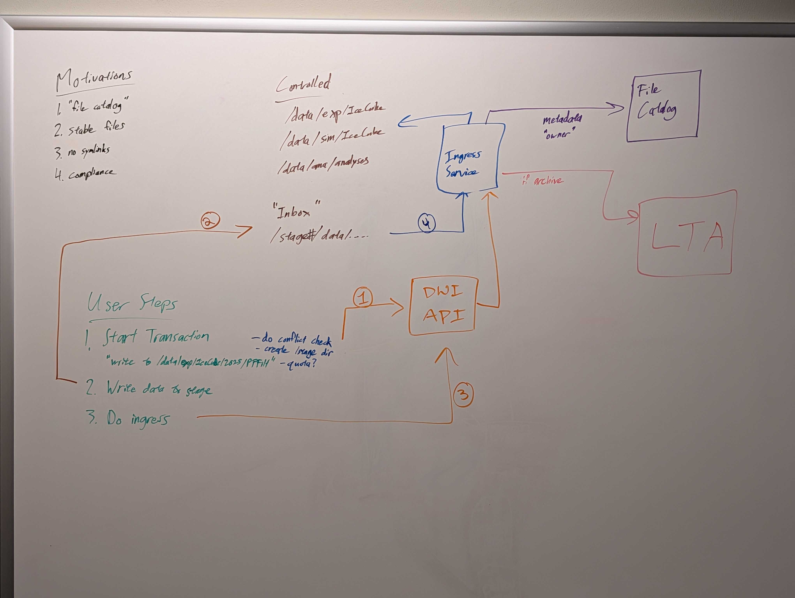

# data-warehouse-ingest

Data warehouse ingestion services.

**Rust Version Requirement**: 1.85+ (edition 2024)



## Quick Navigation

| Component | Documentation | API Reference | Architecture |
|-----------|---------------|---------------|--------------|
| Barbican (Frontend) | [Docs](barbican/src/docs/README.md) | [API](barbican/src/docs/api-reference.md) | [Architecture](barbican/src/docs/architecture.md) |
| Citadel (Backend) | [Docs](citadel/src/docs/README.md) | [API](citadel/src/docs/api-reference.md) | [Architecture](citadel/src/docs/architecture.md) |
| Common (Shared Lib) | [Docs](common/src/docs/README.md) | N/A | [Overview](common/src/docs/overview.md) |

## Project Overview

This is a Rust workspace containing three crates:

- **Barbican**: User-facing frontend service managing inbox metadata.
- **Citadel**: Backend service controlling protected data areas. Ships two
  binaries — `citadel` (long-running HTTP service) and `citadel-job` (one-shot
  job executor, using Kubernetes in production).
- **Common**: Shared library with data models, storage abstractions, and
  infrastructure utilities.

Both services share the `common` crate via workspace dependencies.

## Build & Development

### Workspace Structure

```toml
[workspace]
members = ["citadel", "barbican", "common"]
resolver = "3"
```

### Rust Version

Requires **Rust 1.85+** — all crates use `edition = "2024"`, which mandates
`resolver = "3"` in the workspace root.

### Building

```bash
# Build all crates
cargo build --workspace

# Build specific crate
cargo build -p barbican
cargo build -p citadel
cargo build -p common

# Build Citadel binaries separately
cargo build -p citadel --bin citadel
cargo build -p citadel --bin citadel-job
```

### Testing

```bash
# Run unit + integration tests (uses the `test-integration` alias from .cargo/config.toml)
cargo test-integration
cargo test-integration --workspace   # runs all crates with the integration-tests feature

# Equivalent explicit form
cargo test -p citadel --features integration-tests
cargo test -p common --features integration-tests,test-utils  # common's integration tests use test_utils builders
```

> The `common` auth unit tests pass under `cargo test -p common --features auth`
> (including `config_tests::test_from_env_with_custom_values`).

### Feature Flags

- `common`:
  - `auth` (enables JWT authentication: `jsonwebtoken`, `prometheus`, `once_cell`)
  - `integration-tests` (bare **marker** feature — gates `#[cfg(feature =
    "integration-tests")]` tests in `tests/`; it does not enable anything else)
  - `test-utils` (enables `auth` plus RSA key generation + mock builders for testing)
- `citadel`:
  - `integration-tests` (bare **marker** feature — same gating)
- `barbican`:
  - No local features; depends on `common` with `auth` (normal dep) plus an
    additional `common` **dev-dependency** with `test-utils`. Cargo unifies the
    feature during test compilation, so `cargo test -p barbican` compiles
    Barbican's unit tests (which use `common::test_utils` builders + mock
    store) **without needing an explicit `--features test-utils`** — per
    AGENTS.md, tests run under plain `cargo test`. The normal dependency (auth
    only) keeps `rsa`/`rand` (common's test-only keygen) **out of the Barbican
    production graph** — verified via `cargo tree -p barbican --edges normal`
    (P4.7). Residual: `mockall` stays in the prod graph via `common` (its
    `#[automock]` on `InboxStore` is unconditional); moving that under
    `cfg(any(test, feature = "test-utils"))` is a documented follow-up.

### Dependencies

- **MongoDB** — required for integration tests (CI provides a `mongo:8.0` service container) and at runtime.
- **Kubernetes** — required for the Citadel job executor in production.

## Architecture

Both services are coordinated around the shared `common` crate: Barbican
exposes the user-facing inbox API, and Citadel performs the protected-area
operations behind the scenes.

See detailed architecture docs:

- [Barbican Architecture](barbican/src/docs/architecture.md)
- [Citadel Architecture](citadel/src/docs/architecture.md)
- [Common Overview](common/src/docs/overview.md)

## Barbican

A user frontend for writing files to the Citadel.

MVP: An API allowing limited operations:

| Method | Path | Description |
| ------ | ---- | ----------- |
| `POST` | `/api/v1/inbox` | Create a new inbox |
| `GET`  | `/api/v1/inbox/[id]` | Get info on inbox |
| `DELETE` | `/api/v1/inbox/[id]` | Delete inbox |
| `POST` | `/api/v1/inbox/[id]/publish` | Publish inbox to data warehouse |

### Creating an Inbox

Creating an inbox takes various parameters:

* Final data warehouse path
* Estimated size
* Expected lifetime of inbox
* Should data be archived via LTA?
  * If so, which sites to archive the data at

Additional metadata may be added here in the future.

> Note: if an existing inbox exists for the specified data warehouse path,
> the new request is rejected — the fast in-process check returns `400`, and
> the unique `warehouse_path` index (`uniq_warehouse_path`, created at
> startup) turns a concurrent race or soft-deleted duplicate into a
> `409 Conflict` (P1.5/D3).

### Using an Inbox

Once an inbox has been created, files can be uploaded to it via normal methods.

An inbox is exclusive to a single user, and will not allow group writes.

### Publishing an Inbox

When all data has been uploaded to an inbox and it is ready to be moved into
the data warehouse, the publish action will instruct the Citadel to proceed.
This will lock the inbox while publishing, which is an asynchronous operation.

Publishing takes some time to complete. The inbox status will be updated
as this progresses.

After publishing is completed, the inbox will be automatically deleted by the Citadel.

See full documentation: [Barbican Docs](barbican/src/docs/README.md)

## Citadel

Controls the protected data areas of the data warehouse. This is a backend
service that should not be called by users.

Some available operations:
1. Create a temporary inbox for new data.
2. Move data from an inbox into a protected area.
3. Delete / cleanup an inbox.
4. Inform a file catalog of the newly controlled files.
5. Inform the Long Term Archive of new data that should be archived.

Citadel provides two binaries:

- `citadel`: Long-running HTTP service.
- `citadel-job`: One-shot job executor for file transfers (uses Kubernetes in production).

See full documentation: [Citadel Docs](citadel/src/docs/README.md)

## Common Library

The `common` crate provides shared types and utilities:

- Inbox data model (`InboxDB`, `InboxStatus`, `InboxProgress`, `InboxError`)
- Storage abstraction (`InboxStore` trait)
- Error handling (`AppError`, `AppJson`)
- Infrastructure utilities (logging, metrics, shutdown signals)

See full documentation: [Common Docs](common/src/docs/README.md)

## Configuration

Key environment variables by service:

- **Barbican**: See [Configuration](barbican/src/docs/configuration.md)
- **Citadel**: See [Configuration](citadel/src/docs/configuration.md)
- **Common**: See [Infrastructure](common/src/docs/infrastructure.md)

## Testing

- Unit tests: `cargo test`
- Integration tests: `cargo test-integration` (alias defined in `.cargo/config.toml`; requires MongoDB)
- Test utilities: available in `common` with the `test-utils` feature

See [Testing Guide](common/src/docs/testing.md).

## CI/CD

The CI pipeline (`.github/workflows/ci.yaml`) runs:
`cargo machete`, `cargo fmt -- --check`, `cargo clippy -- --deny warnings`,
`cargo verify-project`, `cargo doc --no-deps`, `cargo build`,
`cargo test-integration`, and `cargo tarpaulin`
(with a `mongo:8.0` service container for tests).

## Health & Readiness Endpoints

| Service | Health | Readiness |
|---------|--------|-----------|
| Barbican | `GET /health` | `GET /ready` |
| Citadel | `GET /health` | `GET /ready` |

## Contributing

See [AGENTS.md](AGENTS.md) for development conventions.

## Additional Resources

- [Barbican Design Plan](barbican/src/docs/01-design-plan.md)
- [Barbican Completion Report](barbican/src/docs/02-completion-report.md)
- [Barbican State Machine](barbican/src/docs/state-machine.md)
- [Citadel State Machine](citadel/src/docs/state-machine.md)
- [Citadel Recursive Transfer](citadel/src/docs/recursive-transfer.md)
- [Citadel Security Considerations](citadel/src/docs/security-considerations.md)
- [Citadel Symlink Limitations](citadel/src/docs/symlink-limitations.md)
- [Common Data Model](common/src/docs/models.md)
